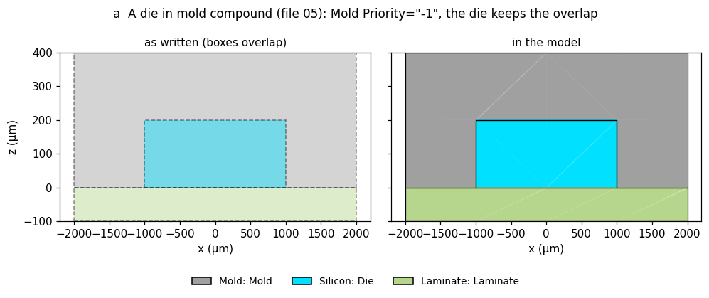
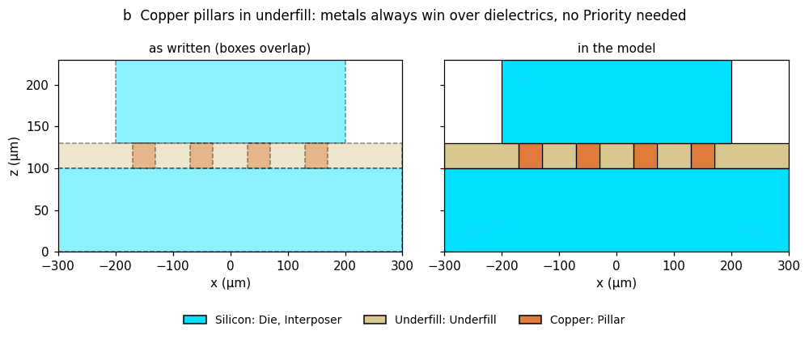
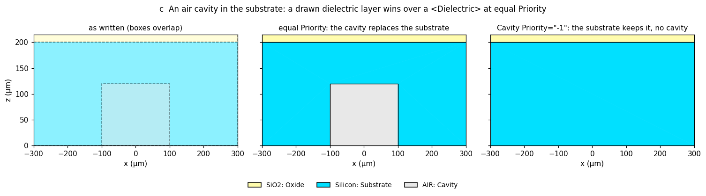
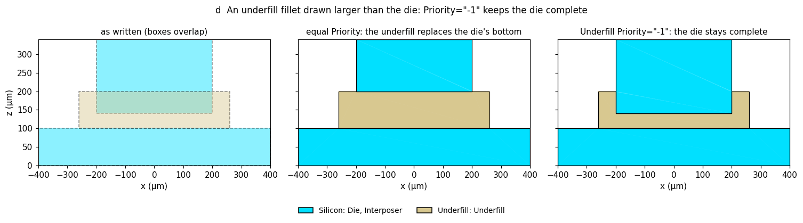
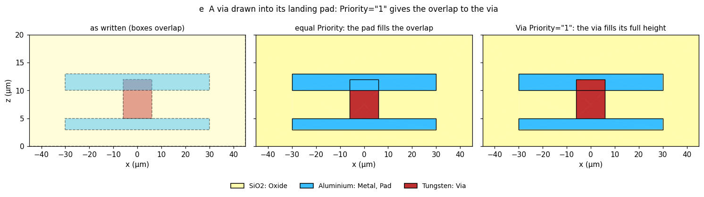

# Stackup XML Format

This document describes the XML file format read by `util_stackup_reader.read_substrate()`.
It defines the process stackup used to build a 3D simulation model from GDSII: materials,
the dielectric stack, the drawn metal/via layers and their GDSII layer numbers, optional
derived (computed) layers, and optional thermal-conductivity tables.

Reference files in this repo: [`SG13G2_200um.xml`](../../XML_stackup/legacy/SG13G2_200um.xml) (basic stackup) and
[`SG13G2_resistors_200um.xml`](../../more_examples/derived_layers_and_resistors/SG13G2_resistors_200um.xml) (adds resistor materials and
derived-layer examples using `AND`/`OR`/`NOT`).

## Top-level structure

```xml
<?xml version="1.0" encoding="UTF-8" standalone="no" ?>
<Stackup schemaVersion="2.0">
  <Variables>              <!-- optional, see "<Variables>" near the end -->
    ...
  </Variables>
  <Materials>
    ...
  </Materials>
  <ELayers LengthUnit="um">
    <Dielectrics>
      ...
    </Dielectrics>
    <Layers>
      ...
    </Layers>
    <DerivedLayers>       <!-- optional -->
      ...
    </DerivedLayers>
  </ELayers>
  <Tables>                 <!-- optional -->
    ...
  </Tables>
</Stackup>
```

`schemaVersion` doesn't change how the reader parses a file (no attribute's meaning branches
on it) — but `read_substrate()` does print a warning if a file declares a `schemaVersion`
newer than `util_stackup_reader.SUPPORTED_SCHEMA_VERSION` (currently `"3.2"`), since such a
file may use attributes this version of the reader doesn't know about yet.

**Unknown attributes.** When a file is read, the reader warns about every attribute and
element it does not know, and names the closest known one (stackup reader 1.11.1):

```
WARNING: stackup file, <Layer Name="Metal1">: attribute DataType is not known and is ignored. Did you mean Datatype?
```

Attribute names are case-sensitive. The warning does not stop the model setup, since a file may
carry extra attributes of another tool: check it before you trust the model.

## `<Materials>`

One `<Material>` element per material, referenced by name from `<Dielectric>` and `<Layer>`
elements later in the file.

> **Note:** `Density`, `ThermalConductivity`, and `ThermalConductivityTable` (also per direction)
> are **not used by S-parameter simulation**. They are only read when this XML file is used in a thermal
> simulation flow — leaving them at their defaults (or omitting them) has no effect on EM
> simulation results.

| Attribute                 | Required | Default | Description |
|----------------------------|----------|---------|--------------|
| `Name`                     | yes      | —       | Material name, referenced elsewhere as `Material="..."`. |
| `Type`                     | yes      | —       | `Conductor`, `Dielectric`, `Semiconductor`, or `Resistor`. |
| `Permittivity`              | no       | `1`     | Relative permittivity (εr). |
| `DielectricLossTangent`     | no       | `0`     | Loss tangent. |
| `Conductivity`               | no       | `0`     | Conductivity in S/m. Used for `Conductor`/`Semiconductor` materials. |
| `Rs`                        | no       | `0`     | Sheet resistance in Ω/square. Used for `Resistor` materials (paired with a zero-thickness `Type="sheet"` layer). |
| `Density`                   | no       | `1`     | Mass density, used by thermal simulation setup. |
| `ThermalConductivity`        | no       | `0`     | Constant thermal conductivity, used by thermal simulation setup. |
| `ThermalConductivityTable`   | no       | —       | Name of a `<Table>` (see [Tables](#tables-thermal-conductivity) below) to use instead of a constant value, for temperature-dependent conductivity. |
| `ThermalConductivity.xy`, `ThermalConductivity.z` | no | — | Thermal conductivity in the lateral (x, y) or vertical (z) direction, instead of `ThermalConductivity` for that direction. See [Direction-dependent thermal conductivity](#direction-dependent-thermal-conductivity). |
| `ThermalConductivityTable.xy`, `ThermalConductivityTable.z` | no | — | The same with a `<Table>` per direction. |
| `Color`                     | no       | —       | Hex RGB color (no `#`), used for 3D preview / GUI display. |

> **Built-in default `"AIR"`:** if the file has no `<Material Name="AIR">` entry, one is added
> automatically (`Type="Dielectric" Permittivity="1.0" DielectricLossTangent="0.0"
> Conductivity="0" Color="d0d0d0"` — the same values used across the example stackups in this
> repo), so `Material="AIR"` just works on a `<Dielectric>`/`<Layer>` without declaring it
> explicitly. Defining your own `<Material Name="AIR">` overrides this default.

```xml
<Materials>
  <Material Name="Metal1" Type="Conductor" Permittivity="1" DielectricLossTangent="0"
            Conductivity="21640000.0" Color="39bfff"/>
  <Material Name="SiO2" Type="Dielectric" Permittivity="4.1" DielectricLossTangent="0.0"
            Conductivity="0" Color="fffcad"/>
  <Material Name="Substrate" Type="Semiconductor" Permittivity="11.9" DielectricLossTangent="0"
            Conductivity="2.0" Color="01e0ff"/>
  <Material Name="RSIL" Type="Resistor" Rs="7" Color="d0d0d0"/>
</Materials>
```

## `<ELayers>`

Container for the dielectric stack and drawn layers. All `Thickness`/`Zmin`/`Zmax`/`Offset`/`Oversize`
values are in the unit of the model script's `settings['unit']` (normally `1e-6`, microns), the
same unit as the GDSII coordinates. `LengthUnit` (typically `"um"`) is informational only: the
reader doesn't use it.

### `<Dielectrics>`

Defines the vertical dielectric stack, independent of GDSII — these layers exist everywhere
and are not drawn as polygons. Order in the file is **top to bottom**. Three ways to position
a `<Dielectric>`, in the order they take priority:

1. **Absolute** — both `Zmin` and `Zmax` given (no `Reference`).
2. **Reference-relative** — `Reference` given (see below).
3. **Implicit stacking** (the default/legacy behavior) — neither of the above: z-positions are
   computed automatically by stacking `Thickness` values from the top down
   (`calculate_zpositions()` walks the list in reverse).

| Attribute       | Required | Default | Description |
|-----------------|----------|---------|--------------|
| `Name`          | yes      | —       | Dielectric name. Must be unique across `<Dielectrics>`. |
| `Material`      | yes      | —       | References a `<Material>` by name. |
| `Thickness`     | yes*     | —       | Layer thickness. Used to auto-stack this dielectric relative to its neighbors, or (with `Reference`) to size it from the reference edge. |
| `Zmin`/`Zmax`   | no       | —       | Absolute z-position instead of `Thickness` (both required together); or, with `Reference` set, offsets from the reference edge (both optional there — see below). |
| `Reference`     | no       | —       | Name of another `<Dielectric>` to position this one relative to. |
| `ReferenceEdge` | no       | `Top`   | `Top` or `Bottom` (case-insensitive). Only meaningful with `Reference` set. |
| `Boundary`      | no       | —       | GDSII layer number that defines this dielectric's finite (x,y) extent in the model. Optional — omit for a dielectric that simply fills the whole simulation domain. |
| `BoundaryDatatype` | no    | —       | GDS datatype of the `Boundary` layer. See [Datatype](#datatype-which-gds-datatype-a-layer-is-read-from). |
| `Priority`      | no       | `0`     | Where dielectrics overlap, the higher Priority keeps the overlap. See [Priority: overlapping volumes](#priority-overlapping-volumes). |

\* `Thickness` is required unless `Zmin`/`Zmax` are both given (absolute mode), or `Zmax` is
given (`Reference` mode).

```xml
<Dielectrics>
  <Dielectric Name="AIR" Material="AIR" Thickness="200.0000" />
  <Dielectric Name="Passive" Material="Passive" Thickness="0.4000" />
  <Dielectric Name="SiO2" Material="SiO2" Thickness="15.7303" />
  <Dielectric Name="EPI" Material="EPI" Thickness="3.7500" />
  <Dielectric Name="Substrate" Material="Substrate" Thickness="180.0000" />
</Dielectrics>
```

With an explicit boundary layer instead of the full domain:

```xml
<Dielectric Name="Package" Material="MoldCompound" Thickness="500" Boundary="299"/>
```

#### Reference-relative positioning (Dielectrics)

Like `<Layer>`'s `Reference` (below), but Dielectrics keep `Thickness` as their primary size
instead of requiring both `Zmin`/`Zmax`: `Zmin` defaults to `0` (start right at the reference
edge — the common case) and `Zmax` defaults to `Zmin + Thickness`. Either can still be given
explicitly to override — e.g. a small designed gap before this dielectric starts.

```xml
<Dielectric Name="SiO2" Material="SiO2" Thickness="15.7303"
            Reference="EPI" ReferenceEdge="Top" />
<!-- equivalent to Zmin="0" Zmax="15.7303" offset from EPI's top edge -->
```

`Reference` on a Dielectric can only target another `<Dielectric>` — never a `<Layer>` (Layers
are resolved after Dielectrics, so the reverse would be a circular pipeline dependency).

**Implicit stacking, made explicit internally:** the reader auto-assigns an in-memory
`Reference` (to the nearest dielectric below it in file order that is *also* using implicit
stacking, `ReferenceEdge="Top"`) to every dielectric that has neither an explicit `Reference`
nor an absolute position — this is purely descriptive (it does not change the computed
z-position, and by default it is **not** written back into the XML file). It lets other code
treat every dielectric's positioning uniformly through `.reference`/`.reference_edge`, and lets
the Stackup Editor's Dielectrics tab show a live Reference-style relationship even for
old-style, purely `Thickness`-stacked files. The Stackup Editor offers, once per file per
editing session at Save time, to write these auto-assigned references into the XML — declining
leaves the file exactly as implicit as before (same resulting z-positions either way).

Note one legacy quirk this auto-assignment deliberately preserves: an absolute-position or
explicit-`Reference` dielectric sitting between two implicit ones is transparent to implicit
stacking — implicit dielectrics keep stacking against each other as if it weren't there, not
against its own `Zmax`. Mixing absolute/Reference dielectrics with implicit ones is uncommon;
if you rely on one sitting directly beneath an implicit dielectric, give that implicit
dielectric an explicit `Reference` instead of relying on file order.

### `<Layers>`

Drawn layers: metals, vias, sheet resistors, and dielectric "bricks" that are read from
specific GDSII layer numbers instead of being implied by the dielectric stack.

An optional `<Substrate Offset="..."/>` element shifts the z-position of every `<Layer>` by
a fixed amount (used e.g. to place the drawn stack on top of a backside/substrate region
that is itself modeled with negative z). A negative `Offset` shifts the layers down
(stackup reader 1.10.0 and newer; before, it was ignored).

| Attribute | Required | Default | Description |
|-----------|----------|---------|--------------|
| `Name`    | yes      | —       | Layer name, used for lookups (`getbylayername`) and in port definitions (`from_layername`/`to_layername` etc. elsewhere in the pipeline). Must be unique across `<Layers>`, and must not collide with a `<Dielectric>` name (see `Reference` below). |
| `Type`    | yes      | —       | `conductor`, `via`, `dielectric`, or `sheet` (see below). |
| `Material`| yes      | —       | References a `<Material>` by name, or the reserved keyword `"PEC"` (see below). |
| `Zmin`    | yes      | —       | Bottom z-position — absolute, or an offset from `Reference`'s edge if `Reference` is set (see below). |
| `Zmax`    | yes      | —       | Top z-position, same absolute-vs-offset rule as `Zmin`. A layer with `Zmax` equal to `Zmin` is a sheet, whatever its `Type`; the numbers are compared, so `Zmin="0.4" Zmax="0.40"` is a sheet too (stackup reader 1.10.0 and newer). |
| `Layer`   | yes      | —       | GDSII layer number. Also used as the target layer number for a [derived layer](#derivedlayers-boolean-operations-on-layers), in which case its geometry does not need to exist directly in the GDSII file. |
| `Datatype` | no      | —       | GDS datatype this layer is read from. Without it: the datatypes given to `read_gds()`. See [Datatype](#datatype-which-gds-datatype-a-layer-is-read-from). |
| `Reference` | no     | —       | Name of another `<Dielectric>` or `<Layer>` to position this layer relative to. When set, `Zmin`/`Zmax` are reinterpreted as offsets from the resolved reference edge instead of absolute z (positive = up). Dielectric and Layer names share one namespace for this lookup, so a name must not exist as both. |
| `ReferenceEdge` | no | `Top`   | `Top` or `Bottom` (case-insensitive). Only meaningful with `Reference` set. For a `<Dielectric>` target: its top/bottom z. For a `<Layer>` target: its `Zmax`/`Zmin`. |
| `Priority` | no | `0` | Where volumes overlap, the higher Priority keeps the overlap: drawn dielectric layers among themselves and with the `<Dielectric>`s, conductors and vias among themselves. See [Priority: overlapping volumes](#priority-overlapping-volumes). |

Layer `Type` meanings:
- **`conductor`** — a normal metal layer with thickness (`Zmax > Zmin`).
- **`via`** — a vertical connection between two conductor layers; eligible for via-array
  merging (`merge_polygon_size` in `read_gds()`).
- **`dielectric`** — a drawn (GDSII-sourced) dielectric region, as opposed to the implicit
  stack in `<Dielectrics>`.
- **`sheet`** — zero-thickness layer (`Zmin == Zmax`). It needs a `Resistor` material (sheet
  resistors) or `PEC` (ideal sheets such as `SUBGND`/`BACKSIDEGND`). With a `Conductor`
  material, the model setup stops with `Invalid material assignment: sheet layer ... must use a
  resistor material!`; a `Resistor` material on a layer with thickness stops it too.

> **Reserved keyword `Material="PEC"`:** valid on a `conductor`, `via`, or `sheet` layer with no
> matching `<Material>` entry at all — it bypasses the `<Materials>` list entirely and is
> emitted as an ideal conductor: ideal Palace `Boundaries.PEC` / Elmer zero-tangential-E
> boundary for a `sheet`, and for a `conductor` with the default surface conductor model. Palace
> and Elmer have no ideal-conductor *volume*, so a `PEC` `via`, and a `PEC` `conductor` meshed as a
> volume (`conductor_model` `'solve_inside'` or `'solve_inside_skin'`), is approximated as a
> fixed, very high conductivity domain instead.
> Use this instead of an ad hoc zero-Ohm/near-infinite-conductivity material - a `Resistor`
> material with `Rs="0"` is rejected by Palace (all of `Rs`/`Ls`/`Cs` zero is invalid).
> In Elmer thermal models (gds2palace 0.8.1 and newer), `PEC` sheets are ignored, like the
> resistor sheets; a `PEC` sheet can still be the target layer of a constant-temperature
> boundary, which uses only its z position. `PEC` vias and conductor volumes use the thermal
> properties of copper.

```xml
<Layers>
  <Substrate Offset="183.75"/>
  <Layer Name="Metal1" Type="conductor" Zmin="1.0400" Zmax="1.4600" Material="Metal1" Layer="8" />
  <Layer Name="Via1"   Type="via"       Zmin="1.4600" Zmax="2.0000" Material="Via1"   Layer="19" />
  <Layer Name="LBE"    Type="dielectric" Zmin="-183.75" Zmax="0"    Material="AIR"    Layer="157" />
  <Layer Name="RSIL"   Type="sheet"     Zmin="0.4"     Zmax="0.4"   Material="RSIL"   Layer="314"/>
</Layers>
```

#### Reference-relative positioning (Layers)

Instead of an absolute z-position, a `<Layer>` can position itself relative to the top or
bottom edge of a named `<Dielectric>` or another `<Layer>`, by setting `Reference`
(+ optional `ReferenceEdge`, default `Top`). `Zmin`/`Zmax` are then offsets from that edge
(positive = up), not absolute z — the layer may lie fully inside, fully outside, or straddle
the reference's own z-range. This avoids hand-recomputing every dependent `<Layer>`'s z-position
whenever a `<Dielectric Thickness="...">` changes; a `<Layer>` can itself be a `Reference`
target for another `<Layer>`, chaining any number of levels deep (resolved in dependency order,
regardless of file order).

```xml
<Layer Name="Metal1" Type="conductor" Material="Metal1" Layer="8"
       Reference="Passive" ReferenceEdge="Top" Zmin="-0.5" Zmax="-0.1" />

<Layer Name="Via1" Type="via" Material="Via1" Layer="19"
       Reference="Metal1" ReferenceEdge="Top" Zmin="0" Zmax="0.54" />
```

Two rules apply:

- **Shared namespace**: `Reference` is looked up against `<Dielectric>` names and `<Layer>`
  names together, so a name must not exist as both. Two `<Layer>`s with the same `Name` stop
  the reader with an error (stackup reader 1.10.0 and newer).
- **Mutual exclusivity with `<Substrate Offset="...">`**: a file must not mix
  `Reference`-based `<Layer>` positioning with a `<Substrate Offset="...">` — it would
  be ambiguous whether the offset applies before or after reference resolution. Use `Reference`
  to point at a backside dielectric's edge directly instead of using `Offset`.

`Reference` is orthogonal to [`<DerivedLayers>`](#derivedlayers-boolean-operations-on-layers) —
a derived layer's own `<Layer>` entry (the one giving it a Z-position/material) can use
`Reference` like any other layer.

### `<DerivedLayers>` (boolean operations on layers)

A file declaring any `<DerivedLayer>` requires `schemaVersion="3.0"` or newer — the same
precedent as the `"2.0"` → `"3.0"` bump for `Reference`/`ReferenceEdge` (both features
predate the `"3.0"` → `"3.1"` bump for `<Variables>`/expressions).

Defines new layer numbers whose geometry is *computed* from other layers (boolean
operations and/or resizing) instead of being read directly from GDSII — e.g. an overlap
between two drawn layers, used here to derive resistor geometry from poly/implant/contact
layers. Full reference, including chaining and self-touching polygon handling, is in
[`derived_layers.md`](derived_layers.md); summary:

- Give the derived layer's target `Layer` number a normal `<Layer>` entry too (as above),
  so it gets a Z-position/material and is included in `metals_list.getlayernumbers()`.
- `Operation` is one of `AND`, `OR`, `XOR`, `NOT` (≥2 `<Operand>` children, folded pairwise
  in order — order matters for `NOT`), or `SIZE` (exactly 1 operand, requires non-zero
  `Oversize`, pure resize with no boolean op).
- `Oversize` (optional, any operation) grows (positive) or shrinks (negative) the result by
  a fixed distance in layout units, applied after the boolean step.
- An `<Operand Layer="...">` can reference a native GDSII layer number or another derived
  layer's number; dependencies are resolved automatically regardless of definition order.
- An operand of a native GDSII layer can name its datatype, `<Operand Layer="68" Datatype="20"/>`,
  see [Datatype](#datatype-which-gds-datatype-a-layer-is-read-from).

```xml
<DerivedLayers>
  <!-- layer 240 = layer 134 (TopMetal2) AND layer 126 (TopMetal1) -->
  <DerivedLayer Name="TM1_TM2_Overlap" Layer="240" Operation="AND">
    <Operand Layer="134"/>
    <Operand Layer="126"/>
  </DerivedLayer>

  <!-- layer 241 = layer 134 minus layer 126 -->
  <DerivedLayer Name="TM2_minus_TM1" Layer="241" Operation="NOT">
    <Operand Layer="134"/>
    <Operand Layer="126"/>
  </DerivedLayer>

  <!-- layer 242 = layer 126, grown by 2 units on every side, no boolean op -->
  <DerivedLayer Name="TM1_grown" Layer="242" Operation="SIZE" Oversize="2">
    <Operand Layer="126"/>
  </DerivedLayer>
</DerivedLayers>
```

Three or more operands are allowed for `AND`/`OR`/`XOR`, folded left to right — used here to
intersect three layers into one resistor recognition layer:

```xml
<DerivedLayer Name="Rhigh_or_Rppd" Layer="311" Operation="AND">
  <Operand Layer="28"/>
  <Operand Layer="14"/>
  <Operand Layer="310"/>  <!-- 310 is itself a derived layer, resolved first -->
</DerivedLayer>
```

## Datatype: which GDS datatype a layer is read from

A GDSII shape has a layer number and a datatype, e.g. 68/20. Without a `Datatype` in the stackup,
a `<Layer>` is read from the datatypes that the model script gives to `read_gds()` (`purposelist`,
datatype 0 if left out). That is enough when a technology uses one layer number per layer, as
IHP SG13G2 does for drawing data.

Some technologies put several things on one layer number and tell them apart by the datatype:
a metal and its keepout, or drawing, pin and fill shapes. For these, a `<Layer>` can name
its datatype (`schemaVersion="3.2"`, stackup reader 1.11.0 and newer, gds2palace 0.13.0):

```xml
<!-- metal and via on the same GDS layer number, as in sky130 -->
<Layer Name="Metal1" Type="conductor" Material="Metal1" Layer="68" Datatype="20" Zmin="1.0" Zmax="1.4"/>
<Layer Name="Via1"   Type="via"       Material="Via1"   Layer="68" Datatype="44" Zmin="1.4" Zmax="1.7"/>
<!-- no Datatype: read from the datatypes given to read_gds(), as before -->
<Layer Name="Metal2" Type="conductor" Material="Metal2" Layer="69" Zmin="1.7" Zmax="2.1"/>
```

Rules:

- **The stackup wins.** A layer with a `Datatype` is read from exactly that datatype, whatever
  `purposelist` the script passes. So a script with `purposelist=[0]` reads such a stackup
  correctly, and nobody has to know the datatypes of the technology.
- A layer without a `Datatype` is read from `purposelist`, as before. The same goes for port
  layers and the marker layers of heat sources.
- Two `<Layer>`s can use the same GDS layer number with different datatypes. Each gets its own
  shapes.
- One datatype per layer. For a layer made of several datatypes, use a derived layer with `OR`
  (below).
- `=` expressions work as in any other attribute.

**Derived layers.** An `<Operand>` can name its datatype too. An operand without one is read
from `purposelist`. An operand that is itself a derived layer has no datatype, and neither has
the `<Layer>` entry of a derived layer: nothing is read from the layout for it.

```xml
<!-- metal drawing and pin shapes together as one metal -->
<DerivedLayer Name="Met1_all" Layer="311" Operation="OR">
  <Operand Layer="68" Datatype="20"/>
  <Operand Layer="68" Datatype="16"/>
</DerivedLayer>
<Layer Name="Metal1" Type="conductor" Material="Metal1" Layer="311" Zmin="1.0" Zmax="1.4"/>
```

**Boundary of a dielectric.** `BoundaryDatatype` does the same for the `Boundary` layer of a
`<Dielectric>`: `Boundary="301" BoundaryDatatype="5"`.

**What `read_gds()` reports.** When the layout has shapes on the layer number of a stackup layer
that are not read, `read_gds()` says so, for stackups with and without `Datatype`:

```
Note: GDS layer 68 (Metal1, Via1): read 68/20, 68/44; in the file but not read: 68/5 (120 polygons)
```

**In code.** A layer with a `Datatype` is identified by a layer id that holds number and
datatype, instead of the plain layer number. `metals_list.getlayernumbers()` returns these ids,
and `read_gds()` takes them, so a model script needs no change. Layers without a `Datatype` keep
their plain number.

The id can be read as it is: a leading 1, five digits for the layer number and five for the
datatype. 68/20 is `10006800020`, i.e. 1 | 00068 | 00020. For checking and debugging:

- A polygon has `poly.gds_layer` and `poly.gds_datatype` next to `poly.layernum`, and
  `print(poly)` shows `Layer = 68/20`.
- A stackup layer has `metal.gds_layernum` and `metal.datatype`;
  `metals_list.get_layer_datatypes()` gives them for all layers.
- `stackup_reader.layer_text(id)` writes an id as `68/20`.
- `allpolygons.print_layers(metals_list)` prints what was read into which layer:

```
Stackup layer  GDS layer  Layer id     Polygons
Metal1         68/20      10006800020  340
Via1           68/44      10006800044  5120
Metal2         69         69           212
-              201        201          1
```

A reader older than 1.11.0 ignores `Datatype` and reads the datatypes of `purposelist`.

In the Stackup Editor, the Layers tab has a "Datatype (optional)" column, the Dielectric Stack
tab "Boundary datatype (optional)", and the operands of a derived layer are written as `68/20`.

## Priority: overlapping volumes

A model is built from volumes: the `<Dielectric>` boxes and the shapes of the drawn layers.
Where two volumes overlap, each point of the overlap can have only one material. `Priority`
decides which: the volume with the higher Priority keeps the overlap, and the overlap is cut out
of the other one.

### The rule

`Priority` is an attribute of `<Dielectric>` and `<Layer>`. It is a whole number, negative values
are allowed, and the default is 0. `=` expressions work as in any other attribute. A file that
uses it declares `schemaVersion="3.2"` (stackup reader 1.11.0 and newer, gds2palace 0.13.0).

Priority compares volumes within two groups:

- **Dielectrics:** the `<Dielectric>`s and the drawn dielectric layers (`<Layer Type="dielectric">`).
- **Metals:** the conductor and via layers.

A metal always wins over a dielectric, whatever their Priority. Priority has no effect on a
sheet (a layer with `Zmin` equal to `Zmax`).

At equal Priority, a built-in order decides. It is the same as before Priority existed, so a
stackup without Priority builds the same model as before:

| Overlap | Winner at equal Priority |
|---|---|
| a conductor or via and any dielectric | the conductor or via (always, Priority can't change this) |
| a drawn dielectric layer and a `<Dielectric>` | the drawn dielectric layer |
| a conductor and a via | the conductor |
| two `<Dielectric>`s | none: gds2palace stops with an error, gds2openEMS prints a warning |

So Priority is needed in two cases only: two `<Dielectric>`s overlap, or the built-in order gives
the wrong material for your structure. The use cases below show both, and the common cases that
need no Priority at all.

### Use cases

The figures are cross-sections through the models that gds2palace builds from these stackups.
The left panel shows the volumes as written, overlapping; the other panels show the model.

**a. A die in mold compound.** The mold is one box over the whole package, the die a smaller box
inside it. The two `<Dielectric>`s overlap, so one of them needs a lower Priority: the mold gets
`Priority="-1"`. The die keeps its full volume, and the mold fills the space around and above
it. No cut-out has to be computed by hand: a change of the die size in the layout is enough.
Without the Priority, gds2palace stops with `ERROR: Dielectrics "Mold" and "Die" overlap and
have the same Priority (0)`. This is example file
[`05_priority_and_directional_k_schemaVersion3.2.xml`](../../more_examples/XML_stackup_format_examples/05_priority_and_directional_k_schemaVersion3.2.xml)
with its layout `layout/05_die_in_mold.gds`.

```xml
<Dielectric Name="Mold" Material="Mold" Zmin="0" Zmax="=mold_thickness" Boundary="301" Priority="-1"/>
<Dielectric Name="Die" Material="Silicon" Zmin="0" Zmax="=die_thickness" Boundary="302"/>
```



**b. Copper pillars in underfill.** The underfill is a `<Dielectric>` over the whole gap between
the die and the interposer, and the pillars are a conductor layer in the same z range. A metal
always wins over a dielectric, so the pillars cut through the underfill. No Priority is needed.

```xml
<Dielectric Name="Underfill" Material="Underfill" Zmin="100" Zmax="130"/>
<Layer Name="Pillar" Type="conductor" Material="Copper" Layer="20" Zmin="100" Zmax="130"/>
```



**c. An air cavity in the substrate.** The cavity, e.g. a local backside etch, is a drawn
dielectric layer inside the substrate `<Dielectric>`. At equal Priority a drawn dielectric
layer wins over a `<Dielectric>`, so the cavity replaces the substrate where it is drawn. No
Priority is needed. The right panel only shows the rule: with `Priority="-1"` on the cavity,
the substrate keeps the overlap, and the cavity is gone.

```xml
<Dielectric Name="Substrate" Material="Silicon" Zmin="0" Zmax="200"/>
<Layer Name="Cavity" Type="dielectric" Material="AIR" Layer="157" Zmin="0" Zmax="120"/>
```



**d. An underfill fillet drawn larger than the die.** Here the built-in order is wrong. The
underfill is a drawn dielectric layer from the interposer up to the fillet height, wider than
the die, and the die is a `<Dielectric>` that starts inside that range. At equal Priority the
drawn layer wins, and the underfill replaces the bottom of the die. With `Priority="-1"` on the
underfill, the die keeps its full volume, and the underfill fills only the gap below it and the
fillet around it.

```xml
<Dielectric Name="Die" Material="Silicon" Zmin="140" Zmax="340" Boundary="302"/>
<Layer Name="Underfill" Type="dielectric" Material="Underfill" Layer="160" Zmin="100" Zmax="200" Priority="-1"/>
```



**e. A via drawn into its landing pad.** The via layer's z range reaches into the pad above it.
At equal Priority the conductor wins, so the pad fills the overlap. That is right when the via
is meant to end at the pad. If the via material should reach its full height, e.g. a tungsten
plug in an aluminium pad in a thermal model, give the via `Priority="1"`. It matters where the
two materials differ and both are volumes: in thermal models, and in EM models with
`conductor_model` `'solve_inside'` or `'solve_inside_skin'`.

```xml
<Layer Name="Pad" Type="conductor" Material="Aluminium" Layer="30" Zmin="10" Zmax="13"/>
<Layer Name="Via" Type="via" Material="Tungsten" Layer="31" Zmin="5" Zmax="12" Priority="1"/>
```



**f. What Priority can't do.**

- Two `<Dielectric>`s that overlap with the same Priority have no winner. gds2palace stops and
  names both; give the one that should fill the overlap a higher Priority. gds2openEMS prints a
  warning, and which one fills the overlap is not defined there.
- A dielectric never wins over a conductor or via, however high its Priority. An air cavity
  with `Priority="10"` doesn't remove a metal that passes through it.
- Two conductor layers that touch or overlap still stop an EM model, as before: put a via layer
  between them. Priority between two conductors matters in thermal models.
- A sheet (`Zmin` equal to `Zmax`) is not a volume: Priority on it has no effect.

### How the tools apply it

**gds2palace (Palace, Elmer EM and thermal)** cuts each overlap out of the volume with the lower
Priority before meshing, and prints a line for each overlap of `<Dielectric>`s. A dielectric
completely inside one with a higher Priority is left out of the model.

**gds2openEMS** gives each volume a CSXCAD priority, which decides the material of each FDTD
cell. With Priority 0 everywhere these are the values used before: `<Dielectric>` 10, via 50,
conductor 200, so the model file is the same. A drawn dielectric layer gets 11, below all metals;
before Priority existed it had 200, the same as a conductor.

**The Stackup Editor** in setupEM has a Priority column on the Dielectric Stack and Layers tabs
(gray for a sheet). The stackup preview marks two overlapping dielectrics only when their
Priority is equal. With different Priority it shows the Priority of both, and their tooltips say
which one keeps the overlap. The preview stays a column of bands, one per dielectric: of two
dielectrics that start at the same height, the one that reaches higher is drawn above, and a
layer in the overlap is drawn once, in the dielectric its `Reference` chain starts from, else in
the one that keeps the overlap.

## `<Tables>` (thermal conductivity)

Optional, sibling of `<Materials>` and `<ELayers>` directly under `<Stackup>`. Defines named
temperature/value lookup tables for materials whose thermal conductivity depends on
temperature (referenced from `<Material ThermalConductivityTable="...">` instead of a
constant `ThermalConductivity`).

```xml
<Tables>
  <Table Name="Si_k_vs_T">
    <Point Temperature="250" Value="170"/>
    <Point Temperature="300" Value="148"/>
    <Point Temperature="350" Value="130"/>
  </Table>
</Tables>
```

```xml
<Material Name="Substrate" Type="Semiconductor" Permittivity="11.9" Conductivity="2.0"
          ThermalConductivityTable="Si_k_vs_T" Color="01e0ff"/>
```

The reader sorts the `<Point>`s by `Temperature` (stackup reader 1.10.0 and newer), so their
order in the file doesn't matter. Two points at the same temperature stop the reader with an
error.

## Direction-dependent thermal conductivity

Some materials conduct heat better along the wafer than through it. Examples are mold compound
and laminates with oriented fillers, thin films, GaN and SiC, and layers that average two
materials, such as a bump layer filled with underfill. A file with `schemaVersion="3.2"`
(stackup reader 1.11.0 and newer, gds2palace 0.13.0) can give such a material one value for the
lateral directions and one for the vertical direction:

| Attribute | Direction |
|-----------|-----------|
| `ThermalConductivity.xy`, `ThermalConductivityTable.xy` | lateral: x and y, the layout plane |
| `ThermalConductivity.z`, `ThermalConductivityTable.z` | vertical: z, normal to the wafer |

```xml
<!-- lateral 0.9, vertical 0.3 W/m/K -->
<Material Name="Mold" Type="Dielectric" Permittivity="3.8"
          ThermalConductivity.xy="0.9" ThermalConductivity.z="0.3"/>

<!-- one value for all directions, overridden vertically -->
<Material Name="BumpLayer" Type="Dielectric" Permittivity="3.5"
          ThermalConductivity="0.5" ThermalConductivity.z="=k_bump_z"/>

<!-- temperature-dependent: one table per direction -->
<Material Name="GaN" Type="Semiconductor" Permittivity="9.0"
          ThermalConductivityTable.xy="GaN_kxy_vs_T" ThermalConductivityTable.z="GaN_kz_vs_T"/>
```

Rules:

- The plain `ThermalConductivity` or `ThermalConductivityTable` stays the value for all
  directions. A direction without its own value uses it.
- The more specific attribute wins: `ThermalConductivity.z` over `ThermalConductivityTable`, for
  example. Between the two plain attributes, the table wins, as before.
- A direction has a constant or a table, not both: `ThermalConductivity.z` together with
  `ThermalConductivityTable.z` stops the reader with an error.
- Only `.xy` and `.z` exist, and only for thermal conductivity. Another suffix
  (`ThermalConductivity.x`) or another property (`Permittivity.z`) stops the reader with an
  error, instead of being ignored.
- `=` expressions work as in any other attribute.

**Older readers.** A reader before 1.11.0 ignores the `.xy` and `.z` attributes and prints its
warning about the newer `schemaVersion`. If the file also has a plain `ThermalConductivity`, it
models the material with that value in all directions. Without one, its thermal setup stops with
"has no ThermalConductivity defined". There is no need to add a plain value only for older
readers: that would be a value nobody measured. An older Stackup Editor keeps the `.xy` and `.z`
attributes when it saves, but doesn't show them.

**Elmer output.** A material with the same value in all directions is written as before. A
direction-dependent one becomes a diagonal tensor, `Heat Conductivity(3) = Real kx ky kz`. If any
direction has a table, all directions go into one table with a column per direction, at the
temperatures of all its tables. Elmer interpolates between the points and extrapolates linearly
outside them, so this gives the same values as the separate tables. With
`fill_factor_correction`, the conductivity of a merged via array is scaled by its fill factor in
every direction. The reader gives the values per direction as `material.thermal_xyz`.

**Stackup Editor.** In the Materials tab, the Thermal Cond. and Thermal Table cells have a
**…** button. It opens a dialog with the values per direction ("Same in all directions" or
"Lateral and vertical"). A direction-dependent material shows a summary in these
cells, e.g. `0.9 · z 0.3`; double-click it or use **…** to edit it.

## `<Variables>`

A file using `<Variables>`/`=`-expressions declares `schemaVersion="3.1"` (see
[`variables_example.xml`](variables_example.xml)) — the same precedent as the `"2.0"` →
`"3.0"` bump for `Reference`/`ReferenceEdge` — so an older reader warns instead of silently
misreading it.

Optional, sibling of `<Materials>` directly under `<Stackup>`. By convention it comes first,
before `<Materials>` (see the [Top-level structure](#top-level-structure) diagram above), but the
reader resolves the variables before anything else wherever the section is. Defines named values that can then
be referenced from *any* attribute value anywhere else in the file (Materials, Dielectrics,
Layers, Substrate, DerivedLayers, Tables — see "Using a variable or equation" below), instead
of hand-copying the same physical value into every attribute/file that needs it.

One `<Variable>` element per value:

| Attribute | Required | Default  | Description |
|-----------|----------|----------|--------------|
| `Name`    | yes      | —        | Variable name. Must be unique across `<Variables>`. |
| `Value`   | yes      | —        | A plain literal (number or string), or a `=`-prefixed expression that may reference other variables (see below). |
| `Min`, `Max` | no   | —        | Lowest and highest allowed value, numbers or `=` expressions. See [Allowed values](#allowed-values). |
| `Step`    | no       | —        | Step size for the allowed range, positive; not checked against the value. |
| `List`    | no       | —        | The allowed values, separated by `;`. Instead of `Min`/`Max`. |
| `Description` | no   | —        | Help text, e.g. the unit. |
| `Type`    | no       | inferred | `number` or `string`. For a plain-literal `Value`, an explicit `Type` controls parsing — `Type="string"` keeps a numeric-looking literal as text instead of it being inferred as a number; if omitted, `Type` is inferred by trying to parse `Value` as a number. For a `=`-expression `Value`, `Type` cannot override the computed result's type — it is instead validated against it, and a mismatch is an error. |

```xml
<Variables>
  <Variable Name="cu_conductivity" Value="21640000.0" />
  <Variable Name="metal_thickness" Value="0.42" />
  <Variable Name="via_thickness"   Value="0.54" />
  <Variable Name="via_top"         Value="=metal_thickness + via_thickness" />
  <Variable Name="metal_color"     Value="39bfff" Type="string" />
</Variables>
```

Variables may reference other variables regardless of declaration order — resolved by
dependency, the same "repeat until no progress, remainder = circular/unresolved → error"
approach already used for `<Layer Reference="...">` (see
[Reference-relative positioning (Layers)](#reference-relative-positioning-layers) above).

### Allowed values

A Variable can declare which values it accepts (`schemaVersion="3.2"`, stackup reader 1.11.0).
The value in the file and every override are checked: `variable_overrides` in a model script,
setupEM's "Override stackup Variables" grid, and the MCP tools. A value outside stops the model
setup with an error that names the variable and its allowed values.

```xml
<Variable Name="total_thickness" Value="200" Min="25" Max="750" Step="5" Description="chip thickness, um" />
<Variable Name="bulk_thickness" Value="=total_thickness - 20" Min="0" />
<Variable Name="mold_thickness" Value="400" Min="=die_thickness" Description="at least the die thickness" />
<Variable Name="thermal_table_choice" Value="Si_vs_T_IHP" Type="string" List="Si_vs_T_IHP;Si_vs_T_literature" />
```

- **`Min`, `Max`:** the lowest and highest allowed value, inclusive. Either one alone is
  allowed. They may be `=` expressions, so one variable can limit another: above, the mold
  must be at least as thick as the die.
- **`List`:** the allowed values, separated by `;`, numbers or text. Numbers are compared as
  numbers (`300` and `300.0` are the same). A variable has a `List` or `Min`/`Max`, not both.
- **`Step`:** a positive step size, shown with the allowed values and meant for spin boxes and
  parameter sweeps. It is not checked against the value.
- **`Description`:** help text, e.g. the unit. setupEM shows it as tooltip in its override grid,
  and the MCP tool `inspect_stackup` reports it.
- A computed variable (`Value="=..."`) can have limits too. All variables are checked after
  they are resolved, so an override that makes a computed value invalid stops as well: with
  `total_thickness` overridden to 15, `bulk_thickness` would be -5.

Examples of the messages:

```
ERROR: Variable "mold_thickness": the override 150 is below its minimum 200
ERROR: Variable "total_thickness": 1000 is outside its allowed range 25 .. 750
ERROR: Variable "thermal_table_choice": the override "Si_new" is not allowed, it must be one of Si_vs_T_IHP, Si_vs_T_literature
```

A reader older than 1.11.0 ignores these attributes and doesn't check anything.

### Using a variable or equation in any attribute

Any attribute value **starting with `=`** is an expression, evaluated with bare identifiers
resolved against `<Variables>`. A plain variable reference is just the trivial one-token case
of an expression — there's no separate reference syntax:

```xml
<Material Name="Metal1" Type="Conductor" Conductivity="=cu_conductivity" Color="=metal_color"/>

<Layer Name="Metal1" Type="conductor" Material="Metal1" Layer="8"
       Zmin="1.04" Zmax="=1.04 + metal_thickness" />
<Layer Name="Via1" Type="via" Material="Via1" Layer="19"
       Zmin="=metal_thickness + 1.04" Zmax="=via_top + 1.04" />
```

A value **without** a leading `=` is a plain literal, parsed as before — this keeps the meaning
of stackup files without variables unchanged. The latest IHP stackups in
[`XML_stackup/latest/IHP/`](../../XML_stackup/latest/IHP/) use expressions, e.g.
`Thickness="=bulk_thickness"` on the substrate.

This applies to every attribute in the file, not only Materials/Dielectrics/Layers — including
`<Substrate Offset="...">`, `<DerivedLayer Layer="..." Oversize="...">` and its `<Operand
Layer="...">` children, and `<Table>`'s `<Point Temperature="..." Value="...">` children. See
[`variables_example.xml`](variables_example.xml) for a complete illustrative file, including
`DerivedLayers` and `Tables` usage.

**Expression syntax:** `+ - * / **`, unary `-`/`+`, parentheses, numeric literals (including
scientific notation, same as accepted by `float()`), quoted string literals, and bare
identifiers naming a `<Variable>`. A `string`-typed variable may only be used as the sole token
in an expression (`=tech_name`, i.e. whole-value substitution) — using a string variable inside
arithmetic is an error. Quotes make a literal, not a variable reference: `="tech_name"` gives
the text `tech_name`. No string concatenation or function calls (`min()`, `max()`, etc.) are
supported.

**Integer attributes:** GDSII layer numbers (`<Layer Layer="...">`, `<DerivedLayer Layer="...">`,
`<Operand Layer="...">`, `<Dielectric Boundary="...">`) are integers — an expression resolving
to a non-integer value used in one of these attributes is an error, not a silent truncation.

## What `read_substrate()` returns

```python
materials_list, dielectrics_list, metals_list = stackup_reader.read_substrate(XML_filename)
```

- `materials_list` — all `<Material>` entries (`stackup_materials_list`). Each material's
  thermal conductivity per direction is `material.thermal_xyz`: three values for x, y and z, each
  a constant or a table.
- `dielectrics_list` — all `<Dielectric>` entries, with z-positions resolved
  (`dielectric_layers_list`).
- `metals_list` — all `<Layer>` entries, sorted by z with above/below neighbors resolved
  (`metal_layers_list`). `metals_list.getlayernumbers()` is the layer list normally passed to
  `gds_reader.read_gds()`.
- `metals_list.derived_layers` — parsed `<DerivedLayers>` entries (empty if the XML has none).
  Not a separate return value, so this signature stays compatible with older 3-value call
  sites; `read_gds()` picks it up automatically from `metals_list` if not passed explicitly.
