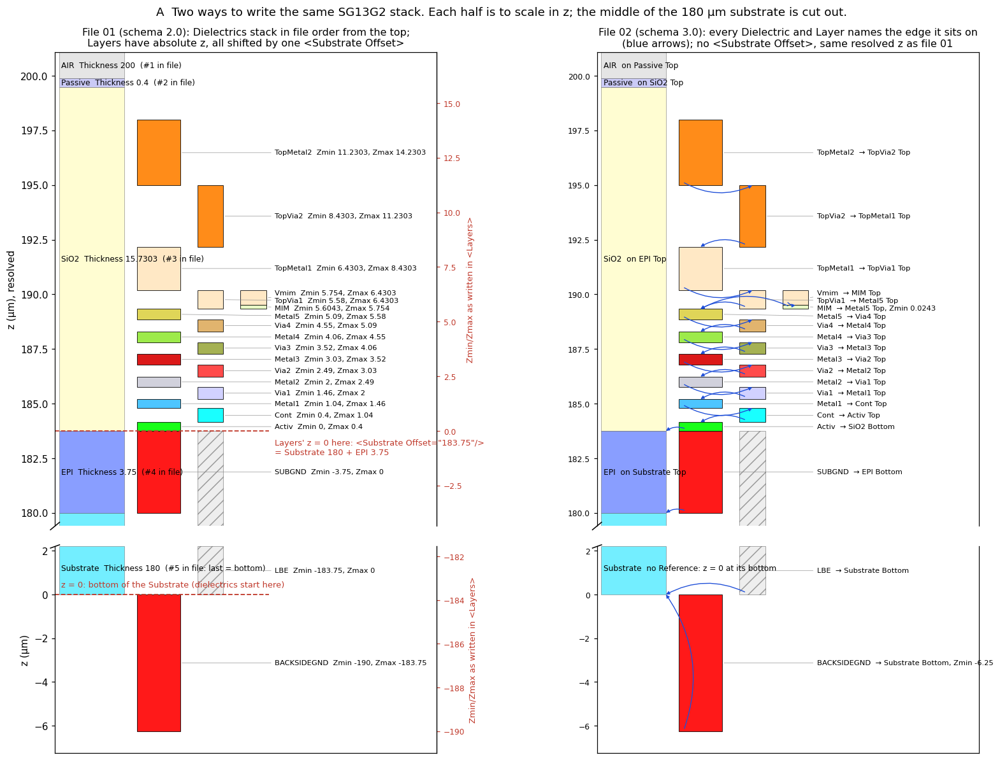
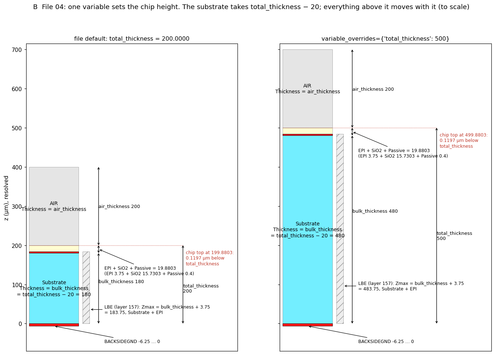
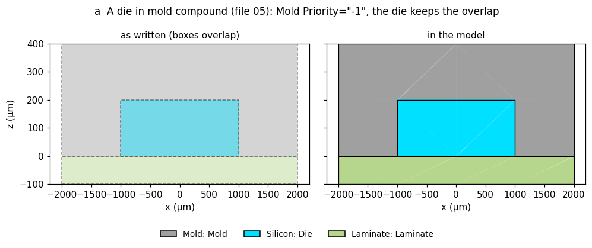

# XML Stackup Format — Feature Progression Examples

Five example stackup files showing how the XML stackup format has evolved. Files 01–04 build
on each other, each one adding exactly one new capability, and describe
**the same physical IHP SG13G2 200 µm stackup** (files 01–03 are verified to resolve
to bit-identical `Zmin`/`Zmax` for every Dielectric and Layer they share), so the diff
between consecutive files is a clean, minimal illustration of that generation's new
attributes — not a change in the modeled geometry. File 05 shows `schemaVersion="3.2"` on a
different structure, a die in mold compound (see "File 05" at the end).

For the full attribute-by-attribute reference, see
[`../../doc/XML_stackup_format/XML_stackup_format.md`](../../doc/XML_stackup_format/XML_stackup_format.md)
and [`../../doc/XML_stackup_format/derived_layers.md`](../../doc/XML_stackup_format/derived_layers.md).
This guide is a tutorial on *what changed and why*, not a restatement of that reference.

## The files

| File | `schemaVersion` | New feature added | Reader version required |
|---|---|---|---|
| [`01_legacy_absolute_positioning_schemaVersion2.0.xml`](01_legacy_absolute_positioning_schemaVersion2.0.xml) | `2.0` | — (baseline format) | any |
| [`02_reference_relative_positioning_schemaVersion3.0.xml`](02_reference_relative_positioning_schemaVersion3.0.xml) | `3.0` | `Reference`/`ReferenceEdge` | 1.6.0+ |
| [`03_variables_and_expressions_schemaVersion3.1.xml`](03_variables_and_expressions_schemaVersion3.1.xml) | `3.1` | `<Variables>` / `"="`-expressions | 1.7.0+ |
| [`04_full_featureset_schemaVersion3.1.xml`](04_full_featureset_schemaVersion3.1.xml) | `3.1` | Everything above **+** `<DerivedLayers>` **+** `<Tables>`, substrate height driven entirely by a variable | 1.7.0+ |
| [`05_priority_and_directional_k_schemaVersion3.2.xml`](05_priority_and_directional_k_schemaVersion3.2.xml) | `3.2` | `Priority`, thermal conductivity per direction and allowed values of Variables, on a different structure: a die in mold compound (layout [`layout/05_die_in_mold.gds`](layout/05_die_in_mold.gds)) | 1.11.0+ |

Reader version numbers refer to `util_stackup_reader.__version__` in this repo's
`workflow/gds2palace/util_stackup_reader.py`. `openems_ihp_sg13g2` carries an
independent copy of the same reader — check that copy's `__version__`/
`SUPPORTED_SCHEMA_VERSION` separately if you're targeting the openEMS flow instead.

The two sketches below are drawn by [`sketches.py`](sketches.py) from these XML files
(output in `png/`).

## Generation 1 → 2: absolute positioning to Reference-relative positioning

File 01 positions every `<Dielectric>` by stacking `Thickness` values top-down in file
order, and every `<Layer>` with an absolute `Zmin`/`Zmax` — with a single
`<Substrate Offset="183.75"/>` shifting the entire drawn (front-side) layer stack up so
it lands on top of the dielectric stack's computed z-position.

File 02 replaces both mechanisms with explicit `Reference`/`ReferenceEdge` attributes:
each Dielectric and Layer names the element it sits on top of (or below), instead of
relying on file order or a single global offset. Two representative changes:

```xml
<!-- 01: implicit stacking, relies on file order -->
<Dielectric Name="SiO2" Material="SiO2" Thickness="15.7303" />

<!-- 02: explicit, order-independent -->
<Dielectric Name="SiO2" Reference="EPI" ReferenceEdge="Top" Material="SiO2" Thickness="15.7303" />
```

```xml
<!-- 01: absolute z, only correct because of <Substrate Offset="183.75"/> elsewhere -->
<Layer Name="Activ" Type="conductor" Zmin="0.0000" Zmax="0.4000" Material="Activ" Layer="1" />

<!-- 02: anchored directly to the dielectric it actually sits against -->
<Layer Name="Activ" Type="conductor" Reference="SiO2" ReferenceEdge="Bottom"
       Zmin="0.0000" Zmax="0.4000" Material="Activ" Layer="1" />
```

Once every `<Layer>` is Reference-based, `<Substrate Offset="..."/>` is no longer
needed (and can't be combined with Reference-based Layers — see the "Mutual
exclusivity" note in the main reference doc). The practical benefit shows up when you
edit the stack later: changing a dielectric's `Thickness` (e.g. a different BEOL stack
height) automatically moves everything referenced to it, with no manual
re-computation of downstream absolute z-values.



Both files give the same stack. In file 01, the `Zmin`/`Zmax` of a Layer are only right
together with the one offset (red): the drawn layers start 183.75 µm up, where the oxide
begins. In file 02, each element points to the edge it sits on (blue arrows), so a change
in one thickness carries through the chain.

## Generation 2 → 3: `<Variables>` and `"="`-expressions

File 03 adds a `<Variables>` block and rewrites a handful of attribute values from
plain literals to `"="`-prefixed expressions referencing those variables — no
Dielectric/Layer structure changes from file 02, only *values*:

```xml
<Variables>
  <Variable Name="air_thickness" Value="200.0000" />
  <Variable Name="total_thickness" Value="200.0000" />
  <Variable Name="bulk_thickness" Value="=total_thickness-20" />
  <Variable Name="via_color" Value="ffe6bf" Type="string" />
</Variables>
```

This demonstrates the three variable kinds side by side:

- **Plain numeric variable** (`air_thickness`) — just a named constant.
- **Expression variable** (`bulk_thickness`) — computed from another variable; used for
  `<Dielectric Name="Substrate" Thickness="=bulk_thickness" />`, so the substrate's
  bulk thickness is derived instead of hand-entered.
- **String-typed variable** (`via_color`) — `TopMetal1` and `TopVia1` happen to share
  the same `Color="ffe6bf"` in the original file; `Type="string"` keeps a
  numeric-looking hex value as text and lets both materials reference it once instead
  of repeating the literal.

Any attribute anywhere in the file can use a `"="`-expression this way — Materials,
Dielectrics, Layers, `<Substrate Offset="...">`, `<DerivedLayers>`, and `<Tables>` are
all fair game (see file 04 for `DerivedLayers`/`Tables` examples).

## Generation 3 → 4: full feature set, including `<DerivedLayers>` and `<Tables>`

File 04 is based on [`../derived_layers_and_resistors/SG13G2_resistors_200um.xml`](../derived_layers_and_resistors/SG13G2_resistors_200um.xml)
— a real, previously-existing example that already combines Reference-relative
positioning, Variables, and `<DerivedLayers>` (resistor recognition layers RHIGH/RPPD/RSIL,
built by boolean operations on poly/implant/contact layers — see
[`derived_layers.md`](../../doc/XML_stackup_format/derived_layers.md) for how that
works). This example adds one more piece to make it a genuinely complete feature
demonstration: a `<Tables>` section with two real Si thermal-conductivity datasets
(literature-reported vs. IHP-measured), and a string `<Variable>` that picks which one
`Substrate` actually uses:

```xml
<Variables>
  ...
  <!-- selects which <Table> below Substrate's ThermalConductivityTable resolves to -->
  <Variable Name="thermal_table_choice" Value="Si_vs_T_IHP" Type="string" />
</Variables>
...
<Material Name="Substrate" ... ThermalConductivityTable="=thermal_table_choice" .../>
...
<Tables>
  <Table Name="Si_vs_T_literature"> ... </Table>
  <Table Name="Si_vs_T_IHP"> ... </Table>
</Tables>
```

This is the realistic use of a string variable inside `<Tables>`: swap datasets by
changing one `<Variable Value="...">` (or overriding `thermal_table_choice` via
`variable_overrides=` in a script, with no XML edit at all) — not by editing `<Table>`
data itself. (`Tables`/`DerivedLayers` don't themselves bump `schemaVersion` — only
`Reference`/`ReferenceEdge` and `Variables`/expressions do.)

**Substrate height as a variable:** the substrate's bulk thickness is entirely
variable-driven, exactly as in the source file — `total_thickness` sets the overall
chip height, and `bulk_thickness = total_thickness - 20` derives the substrate's
`Thickness` from it:

```xml
<Variables>
  <Variable Name="total_thickness" Value="200.0000" />
  <Variable Name="bulk_thickness" Value="=total_thickness-20" />
</Variables>
...
<Dielectric Name="Substrate" Material="Substrate" Thickness="=bulk_thickness" />
...
<Layer Name="LBE" ... Reference="Substrate" ReferenceEdge="Bottom" Zmin="0.0000"
       Zmax="=bulk_thickness + 3.7500" .../>
```

Changing only `total_thickness` (e.g. via a script's `variable_overrides=` parameter to
`read_substrate()`, without editing the XML at all) changes the substrate thickness and
every layer positioned relative to it consistently — confirmed here by overriding
`total_thickness` to `500`, which correctly moves the `Substrate` dielectric's `zmax`
from `180` to `480`.



Only the substrate grows. The oxide stack and the air keep their thickness and move up
with it, and LBE (substrate + EPI) follows. The "20" in `bulk_thickness` stands for
EPI + SiO2 + Passive, which add up to 19.8803 µm in this file: the chip top ends 0.12 µm
below `total_thickness`.

### Using `variable_overrides` from a gds2palace model script

`read_substrate()`'s `variable_overrides` parameter lets a model `.py` script override
any `<Variable>` from the command line / top-of-script settings, without touching the
XML file — the same mechanism
[`../derived_layers_and_resistors/palace_resistors_rsil.py`](../derived_layers_and_resistors/palace_resistors_rsil.py)
already uses for `total_thickness`/`air_thickness`. The same pattern extends naturally
to the string-typed `thermal_table_choice` variable added in this file:

```python
XML_filename = "04_full_featureset_schemaVersion3.1.xml"

# override <Variable>s from XML_filename. Set to None to use the value declared
# in XML_filename as-is.
total_thickness = 50            # microns - overall chip height
air_thickness = 20              # microns - air gap above the top metal
thermal_table_choice = "Si_vs_T_literature"   # or "Si_vs_T_IHP" / None

variable_overrides = {}
if total_thickness is not None:
    variable_overrides['total_thickness'] = total_thickness
if air_thickness is not None:
    variable_overrides['air_thickness'] = air_thickness
if thermal_table_choice is not None:
    variable_overrides['thermal_table_choice'] = thermal_table_choice

materials_list, dielectrics_list, metals_list = stackup_reader.read_substrate(
    XML_filename, variable_overrides=variable_overrides)
```

`total_thickness`/`air_thickness` are numeric overrides (resize the chip for a thinner
or thicker package, without hand-editing dielectric thicknesses); `thermal_table_choice`
is a string override (swap which measured/literature dataset a thermal simulation uses)
— both go through the same `variable_overrides` dict, keyed by `<Variable Name="...">`.
An override for a variable that isn't declared in the file's `<Variables>` section is an
error (`read_substrate()` prints an error and exits), so this fails fast if a script and
an XML file drift apart.


## Generation 4 → 5: Priority, thermal conductivity per direction and allowed values

File 05 demonstrated schemaVersion 3.2 and is a different stackup than files 01–04: a silicon die in mold compound on a
package laminate, for an Elmer thermal model. Its layout is
[`layout/05_die_in_mold.gds`](layout/05_die_in_mold.gds). It shows the features of `schemaVersion="3.2"`:

- **Priority.** The `Mold` box (GDS boundary layer 301, the package outline) and the `Die`
  box (boundary layer 302) overlap. `Mold` has `Priority="-1"`, so the die keeps the overlap:
  the mold fills the space around and above the die, and no cut-out has to be computed by
  hand. Without the Priority, gds2palace stops, because two `<Dielectric>`s overlap with the
  same Priority.
- **Thermal conductivity per direction.** `Laminate` has `ThermalConductivity.xy` for the
  lateral directions and `ThermalConductivity.z` for the vertical direction. gds2palace
  writes it to Elmer as `Heat Conductivity(3) = Real kx ky kz`.
- **Allowed values of Variables.** `mold_thickness` has `Min="=die_thickness"`: the mold must be
  at least as thick as the die. An override below, e.g. `variable_overrides={'mold_thickness': 150}`,
  stops with `Variable "mold_thickness": the override 150 is below its minimum 200`. Every
  thickness has a `Description` with its unit.

The thermal conductivities of `Mold` and `Laminate` are placeholders that show the syntax,
not material data: replace them with the values of your materials. Silicon uses the same
temperature table as
[`../thermal_simulation_using_Elmer/`](../thermal_simulation_using_Elmer/). The file has no
permittivities, so it is for thermal models only.

| GDS layer | Content |
|---|---|
| 301 | package outline: x, y size of `Mold` and `Laminate` |
| 302 | die outline: x, y size of `Die` |
| 201 | heat source marker, on the layer `Hotspot` (the top 5 µm of the die) |
| 202 | constant temperature marker, on the sheet `BOTTOM` (the bottom of the laminate) |

A thermal model script uses them like this (see
[`../thermal_simulation_using_Elmer/`](../thermal_simulation_using_Elmer/) for a complete
script):

```python
materials_list, dielectrics_list, metals_list = stackup_reader.read_substrate(
    "05_priority_and_directional_k_schemaVersion3.2.xml")
thermal_objects = simulation_setup.all_thermal_objects()
thermal_objects.add_heatsource(simulation_setup.heatsource(power=1.0, source_layernum=201, target_layername="Hotspot"))
thermal_objects.add_consttemp(simulation_setup.constanttemp(temp=300, source_layernum=202, target_layername="BOTTOM"))
layernumbers = metals_list.getlayernumbers() + thermal_objects.layers
allpolygons = gds_reader.read_gds("layout/05_die_in_mold.gds", layernumbers, purposelist=[0], metals_list=metals_list,
                                  gds_boundary_layers=dielectrics_list.get_boundary_layers())
```

The model setup prints `Dielectric "Mold" (Priority -1) overlaps "Die" (Priority 0): the
overlap belongs to the higher Priority`. The figure below is a cross-section through this model.
This and four more use cases of Priority are explained in "Priority: overlapping volumes" in
[`XML_stackup_format.md`](../../doc/XML_stackup_format/XML_stackup_format.md#priority-overlapping-volumes).



### Datatype per layer

`schemaVersion="3.2"` has one more feature, which file 05 doesn't need: a `<Layer>` can name the
GDS datatype it is read from. Use it for a technology that puts several things on one GDS layer
number and tells them apart by the datatype, e.g. a metal and its keepout.

```xml
<Layers>
  <!-- two layers on GDS layer 68: each is read from its own datatype -->
  <Layer Name="Metal1" Type="conductor" Material="Metal1" Layer="68" Datatype="20" Zmin="1.0" Zmax="1.4" />
  <Layer Name="Via1"   Type="via"       Material="Via1"   Layer="68" Datatype="44" Zmin="1.4" Zmax="1.7" />
  <!-- no Datatype: read from the datatypes given to read_gds(), datatype 0 if none are given -->
  <Layer Name="Metal2" Type="conductor" Material="Metal2" Layer="69" Zmin="1.7" Zmax="2.1" />
</Layers>
```

The stackup decides: a layer with a `Datatype` is read from that datatype, whatever datatypes
the model script passes to `read_gds()`. The script itself needs no change:

```python
materials_list, dielectrics_list, metals_list = stackup_reader.read_substrate(XML_filename)
layernumbers = metals_list.getlayernumbers()
allpolygons = gds_reader.read_gds(gds_filename, layernumbers, purposelist=[0], metals_list=metals_list)
allpolygons.print_layers(metals_list)     # optional: what was read into which layer
```

`read_gds()` prints a note when the layout has shapes on a stackup layer's number that are not
read, and `print_layers()` lists what was read:

```
Note: GDS layer 68 (Metal1, Via1): read 68/20, 68/44; in the file but not read: 68/5 (120 polygons)

Stackup layer  GDS layer  Layer id     Polygons
Metal1         68/20      10006800020  340
Via1           68/44      10006800044  5120
Metal2         69         69           212
```

In a derived layer, an operand can name its datatype in the same way, e.g. to make one metal from
drawing and pin shapes:

```xml
<DerivedLayer Name="Met1_all" Layer="311" Operation="OR">
  <Operand Layer="68" Datatype="20" />
  <Operand Layer="68" Datatype="16" />
</DerivedLayer>
```

The rules are in "Datatype" in
[`XML_stackup_format.md`](../../doc/XML_stackup_format/XML_stackup_format.md#datatype-which-gds-datatype-a-layer-is-read-from).
