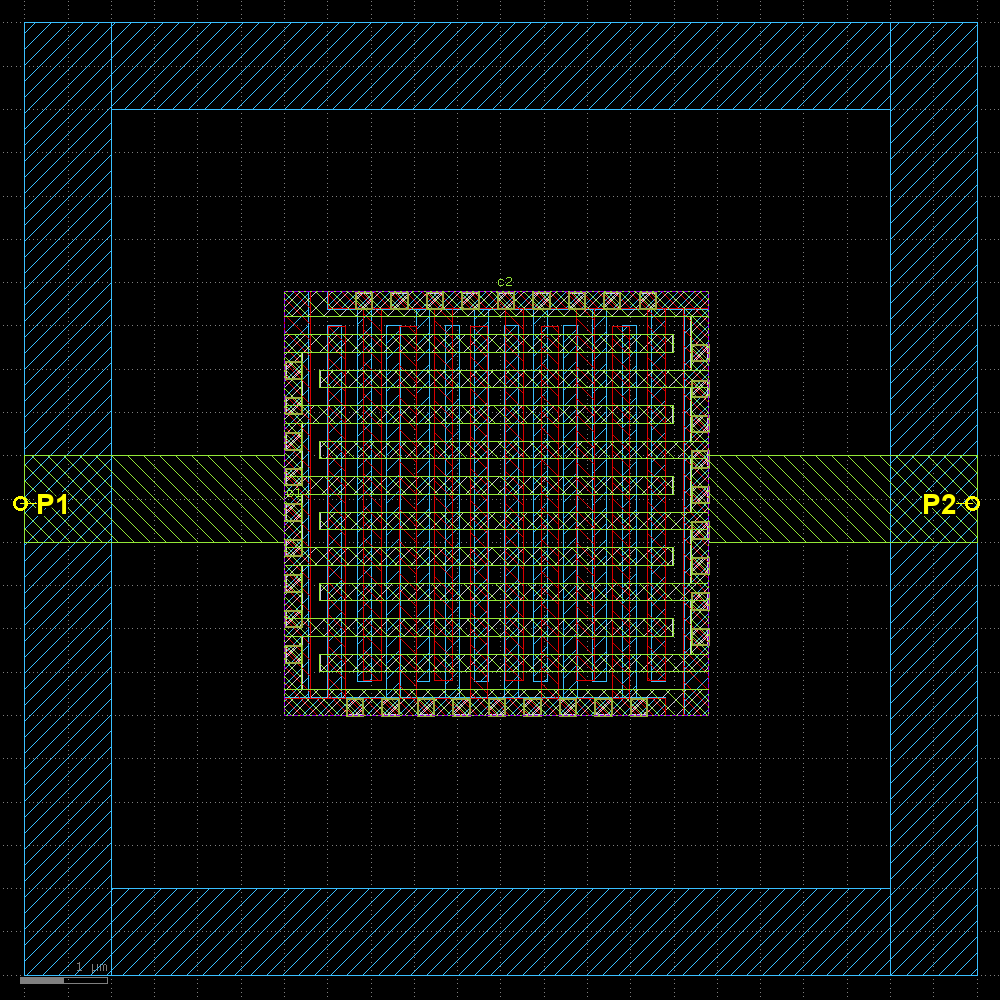
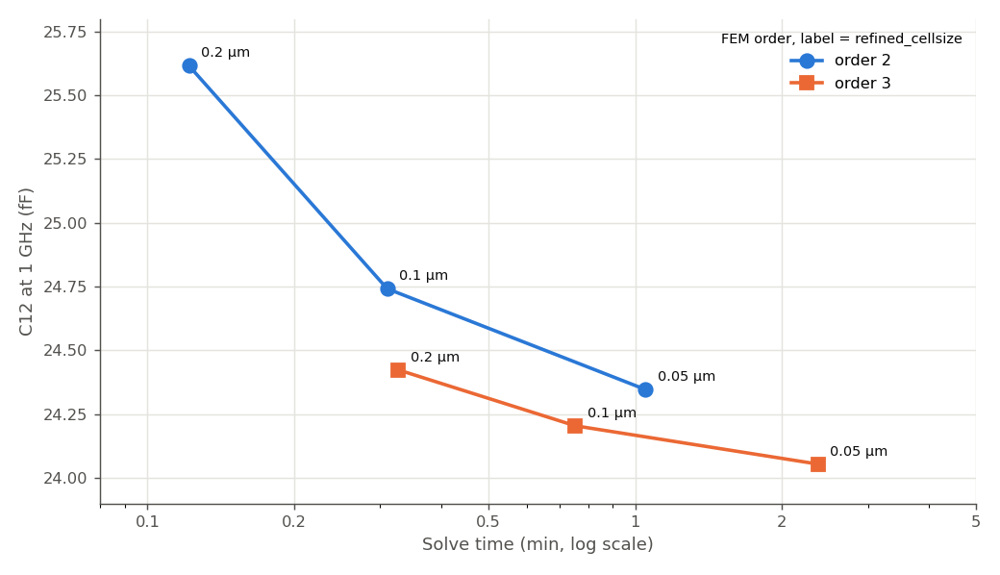

# How fine a mesh does this MOM capacitor need? (IHP SG13CMOS5L)

This study asks a practical question for one specific layout: a small interdigitated MOM capacitor on IHP's new **SG13CMOS5L** stackup. How fine must the Palace mesh be to get its capacitance right, and is FEM order 2 enough, or does order 3 pay off?

We answer this in three steps:

1. **Refine the mesh at order 2** from 0.2 µm to 0.05 µm and watch the capacitance.
2. **Repeat at order 3**, as an independent route to the answer.
3. **Compare both on accuracy vs. cost.**

The findings apply to this capacitor, with this stackup. Other structures can behave quite differently. The [overview page](../README.md) collects the other mesh studies.

## The details of this study

- **Model:** `c4_frame_ports.gds`, stackup `SG13CMOS5L_150um.xml`
- **Ports:** 2 via ports (Metal1 → Metal4), Z0 = 50 Ω. Raw S/Y-parameters, no de-embedding. The port parasitics are the same in every run, so they don't affect the comparison, but absolute values shouldn't be compared with de-embedded results from other studies.
- **Solver:** AWS Palace (FEM), ABC boundaries, 10 µm margin
- **Frequency:** single point at 1 GHz. One extra run sweeps 0–50 GHz (see the end of step 3).
- **Execution:** `hpz2`, 16 of 32 cores, Palace 0.20.0, models from gds2palace 0.10.7 (rerun in November 2026)

**What changed with the November 2026 rerun.** The first version of this study used Palace 0.16 and gds2palace from before October 2026. The capacitances changed by 0.15% or less. The runs became 2 to 4 times faster with Palace 0.19.0, because gds2palace now sets Palace's complex coarse solve by default (since 30 September 2026). The numbers shown here are from Palace 0.20.0, solved in November 2026 on the meshes of the Palace 0.19.0 runs. The results are the same with both versions. With 0.20.0 the runs take 40 to 50% less time and 30 to 45% less memory. The largest run, order 3 at 0.05 µm, peaks at 54 GB.

## 0. Layout



The capacitor is built from fingers on Metal1 to Metal4, with the finger direction rotated by 90° from one metal layer to the next. This uses both the lateral coupling between fingers and the vertical coupling between layers. Fingers are 0.16–0.20 µm wide with 0.18–0.21 µm gaps, much finer than in the other studies here, which is why the mesh sizes are in tens of nanometers. P1 and P2 feed the capacitor from left and right. An outer metal frame surrounds it.

**What we look at.** The coupling capacitance between the two ports, from the Y-parameters: **C12 = −Im(Y12)/ω**. The S-parameters carry the same information: S11 hardly changes at all, and S21 changes in step with C12.

## 1. Order 2: refining the mesh

At order 2, C12 comes out at:

| Mesh | C12 | Change from previous step | Solve time | Peak RAM |
|---|---:|---:|---:|---:|
| 0.2 µm | 25.62 fF | | 7 s | 5.4 GB |
| 0.1 µm | 24.74 fF | −3.4% | 19 s | 12.2 GB |
| 0.05 µm | 24.35 fF | −1.6% | 1m 3s | 30.8 GB |

The capacitance **falls with every refinement**, and each step is about half the previous one. A coarse mesh overestimates the capacitance. The trend is clean, but at 0.05 µm (3–4 cells across a finger) it has not stopped yet.

## 2. Order 3: an independent route

Raising the FEM order improves accuracy without changing the mesh. At order 3:

| Mesh | C12 | Change from previous step | Solve time | Peak RAM |
|---|---:|---:|---:|---:|
| 0.2 µm | 24.42 fF | | 20 s | 9.3 GB |
| 0.1 µm | 24.20 fF | −0.9% | 45 s | 21.6 GB |
| 0.05 µm | 24.05 fF | −0.6% | 2m 22s | 53.6 GB |

Order 3 falls the same way, but in much smaller steps: it starts close to where order 2 ends. Even the finest order-2 result is still 1.2% above the finest order-3 result. **The best estimate here is 24.05 fF** (order 3, 0.05 µm). Since that sequence is also still falling slowly, the true value is probably slightly lower.

## 3. Accuracy vs. cost

Putting both orders on one chart against solve time shows which route gets closer for the same effort:



- **At equal cost, order 3 wins.** Order 3 at 0.2 µm (20 seconds) is already close to order 2 at 0.05 µm (1 minute), and order 3 at 0.1 µm (45 seconds) is better than any order-2 run.
- **Order 3 at 0.1 µm is a good working point for this capacitor**: within 0.6% of the best estimate, in about 45 seconds and 22 GB.
- **Order 2 on a coarse mesh overestimates C12 noticeably**: +6% at 0.2 µm. That's fine for a first look, not for a final value.

**Frequency dependence.** A separate 0–50 GHz sweep at the coarsest setting (0.2 µm, order 2) shows C12 rising smoothly by 2.8% from 25 MHz to 50 GHz, with no resonance ([plot](results/plots/c12_vs_frequency.png)). The absolute level of that sweep carries the +6% coarse-mesh bias. Only its shape is meaningful.

This sweep needed a change in the rerun. On a mesh this fine, Palace can't solve reliably at very low frequency: the frequency-dependent part of the equations gets lost in rounding. The 10 MHz point that gds2palace used to put in place of 0 Hz stopped with "singular matrix". Since gds2palace 0.10.7, that point moves up for cell sizes below 0.5 µm (here to 25 MHz), see the FAQ "Why can't I simulate at 0 Hz, and how is DC handled?". With Palace 0.19.0 the script also set `settings['complex_coarse_solve'] = False`, because the default complex coarse solve could stop abruptly near that limit. With Palace 0.20.0 the default settings solve the 25 MHz point, and the real coarse solve is the worse choice there: it gave a C12 value 3% too low at 25 MHz. So the script now uses the defaults.

## Summary for this capacitor

- **Capacitance converges from above**: coarser meshes and lower order both overestimate it.
- **Order 2 alone isn't enough when the exact value matters.** Even at the finest mesh it stays 1.2% above order 3.
- **Use order 3 at 0.1 µm** for this capacitor: within about 0.6% of the best estimate, in under a minute (22 GB of RAM).
- **For a frequency sweep on a sub-micron mesh, don't go below a few tens of MHz.** The lowest frequency Palace can solve rises as the cells get smaller.

These numbers belong to this layout. Finger sizes, layer count and stackup all change them. For any capacitive structure, one order-3 run is a worthwhile check.

## Files

```
mesh_convergence_mom_cmos5l/
├── c4_frame_ports.gds, SG13CMOS5L_150um.xml       # layout and stackup
├── c4_frame_ports.py                              # base model
├── c4_frame_ports_mesh{200,100,50}nm.py           # order 2, fixed 1 GHz
├── c4_frame_ports_mesh{200,100,50}nm_order3.py    # order 3, fixed 1 GHz
├── c4_frame_ports_mesh200nm_sweep.py              # 0-50 GHz sweep, 0.2 µm, order 2
├── palace_model/c4_frame_ports_<name>_data/       # made by the model scripts, not in the repository: mesh, config and Palace output per run
└── results/
    ├── story_plots.py             # the story_c12_vs_cost.png plot and numbers in this report
    ├── analyze_convergence.py     # C12 and ΔS tables (CSV), C12 and S-parameter plots
    ├── capacitance_convergence.csv, order_comparison.csv, c12_vs_frequency.csv
    ├── delta_S_table_order{2,3}.csv, delta_S_vs_finest_order{2,3}.csv
    ├── snp/                       # raw 2-port Touchstone files, one per run
    └── plots/
```

Run the scripts from this folder in a venv with gds2palace, scikit-rf and matplotlib to regenerate plots and tables from the archived Touchstone files.
